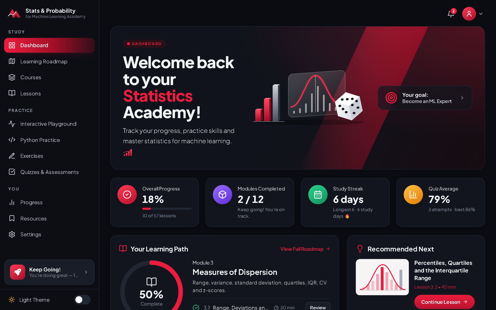
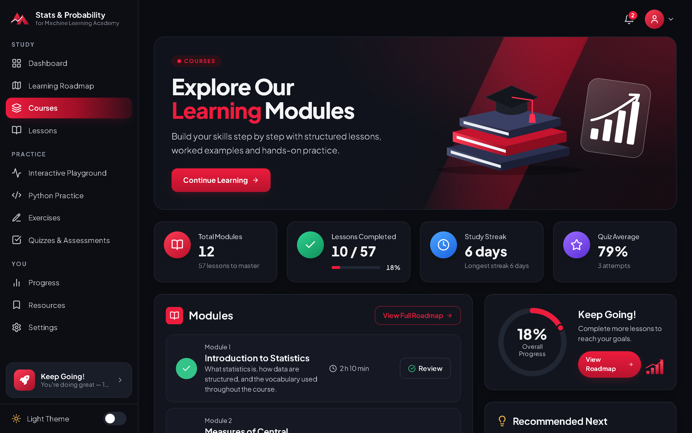
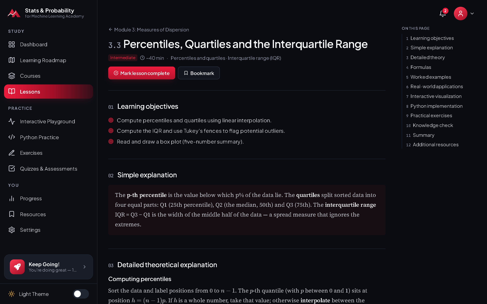
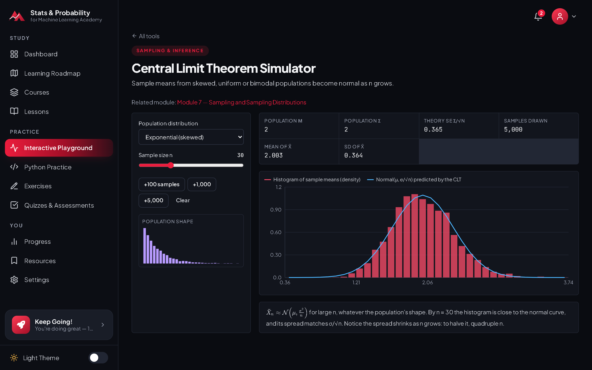
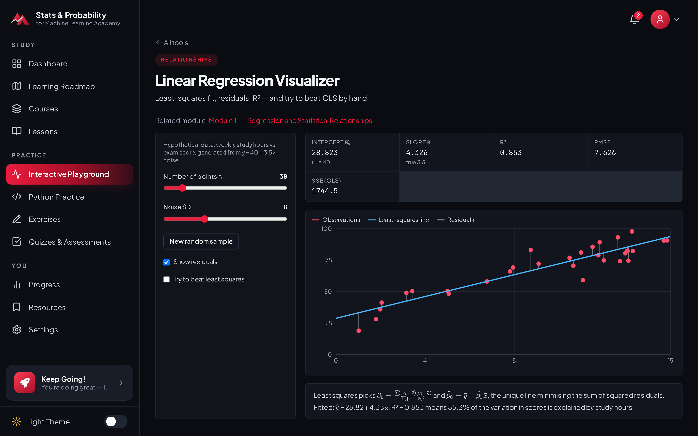

# Statistics & Probability for ML Academy — Preview

A self-study web platform that teaches **statistics and probability from absolute beginner level up to the foundations needed for Machine Learning, AI and Data Science**. This repository is a visual preview of the app; the source code lives in [abdimajeet/statistics](https://github.com/abdimajeet/statistics).

## Highlights

- **12 complete modules, 57 lessons** — from "What is statistics?" to MLE/MAP and the bias–variance trade-off.
- **A consistent 12-part lesson format** — objectives, simple explanation, theory, formulas, worked examples, ML applications, interactive visualisation, Python, exercises, knowledge check, summary and resources.
- **42 interactive tools** — simulators and calculators for distributions, the Central Limit Theorem, confidence intervals, hypothesis tests, regression, Bayes' theorem and more.
- **228 exercises, a 162-question assessment bank and 36 Python exercises**, with weak-topic analysis that points back to the lessons to revise.
- **Progress tracking** — study streaks, quiz averages, module completion and a learning record.
- **Google sign-in and cloud sync** — progress is saved to MongoDB Atlas and follows you to any device.
- **Dark and light themes**, fully responsive down to phone screens.

## Tech stack

| Area | Technology |
| --- | --- |
| Frontend | React 18, Vite 6, Tailwind CSS v4, React Router |
| Charts & maths | Recharts, KaTeX, highlight.js |
| Backend | Node.js, Express |
| Database | MongoDB Atlas |
| Auth | Google Identity Services, JSON Web Tokens |
| Hosting | Vercel (website), Render (API) |

## Screenshots

All screenshots are captured at 2× resolution (2880×1800 on desktop, 1170×2532 on mobile) and show a demo learner partway through Module 3.

### Dashboard
Progress overview, study streak, quiz average, the current module on the learning path and the recommended next lesson.

### Courses
All twelve modules with durations, completion state and sequential unlocking.

### Learning roadmap
Four phases — Foundations, Probability, Inference and Modelling — with why each module matters for machine learning.

### Lesson
Every lesson follows the same twelve-part structure, with an outline to jump between sections.

### Formulas
Formulas rendered with KaTeX, each with its symbols explained.

### Worked examples
Step-by-step examples with real numbers, so every result can be reproduced by hand.

### Central Limit Theorem simulator
5,000 sample means of size 30 drawn from a skewed population line up with the normal curve the CLT predicts.

### Linear regression visualiser
Fit a least-squares line, inspect residuals and see how slope and R² respond to the data.

